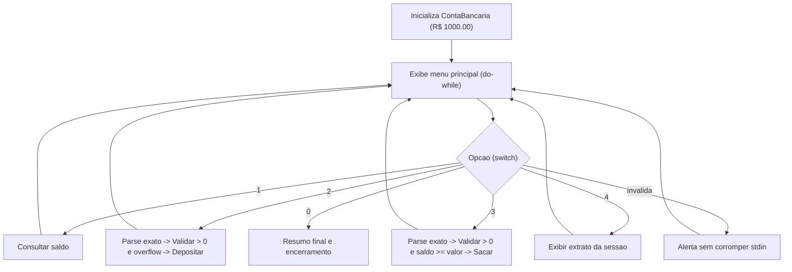

# Sistema Bancário Digital em C11

Simulador interativo de conta bancária implementado em **C11** com estruturas de repetição (`do-while`) e decisão (`switch`), evoluído com separação limpa entre núcleo de domínio e CLI, **aritmética monetária exata em centavos (`int64_t`)**, histórico de transações em memória, parsing resiliente de entrada e CI automatizado com `gcc`, `clang`, AddressSanitizer e UBSan.

[](https://github.com/cgn2222/ads-algoritmos-sistema-bancario/actions/workflows/ci.yml)


---

## Fluxo operacional



---

## Como compilar e executar

```bash
# Compilar (-std=c11 -Wall -Wextra -Wpedantic -Werror)
make

# Executar simulador interativo
make run

# Rodar testes unitarios + teste de integracao da CLI
make test

# Rodar testes com AddressSanitizer e UndefinedBehaviorSanitizer
make sanitize
```

### Exemplo de sessão

```text
========== MENU PRINCIPAL ==========
1 - Consultar Saldo
2 - Realizar Deposito
3 - Realizar Saque
4 - Consultar Extrato
0 - Sair do Sistema
====================================
Digite a opcao desejada: 2

--- REALIZAR DEPOSITO ---
Informe o valor para deposito (R$): 250,50
Deposito de R$ 250.50 realizado com sucesso!
Novo saldo atual: R$ 1250.50
```

---

## Decisões de engenharia e trade-offs

| Decisão | Justificativa | Trade-off / Evolução |
| --- | --- | --- |
| **Saldo em `int64_t` centavos (em vez de `float`/`double`)** | Elimina erro de representação binária IEEE-754 (`0.1 + 0.2 != 0.3`) e garante aritmética financeira exata com proteção explícita contra overflow (`INT64_MAX`). | Requer parser próprio (`conta_parse_centavos`) para converter strings decimais diretamente para inteiro sem passar por ponto flutuante. |
| **Leitura com `fgets` + `strtol` em vez de `scanf`** | Elimina o bug clássico de loop infinito quando texto não numérico é digitado no menu. | Exige limpeza manual de `\r\n` e espaços, mas garante previsibilidade sob entradas malformadas. |
| **Domínio desacoplado (`conta.c`) da CLI (`main.c`)** | Permite testar cada regra de negócio (saldo insuficiente, valor negativo, overflow, extrato) isoladamente em milissegundos. | Facilita evoluir para persistência em arquivo ou banco de dados sem reescrever as regras da conta. |
| **Histórico limitado em buffer estático (`CONTA_MAX_HISTORICO = 100`)** | Zero alocações dinâmicas (`malloc`/`free`) e zero risco de memory leak em uma aplicação didática de sessão única. | Em produção com histórico ilimitado, persistir eventos em ledger append-only em banco transacional. |

---

## Estrutura do repositório

```text
ads-algoritmos-sistema-bancario/
├── .github/workflows/ci.yml   # CI com gcc, clang, ASan e UBSan
├── Makefile                   # Build estrito C11, testes e sanitizers
├── src/
│   ├── conta.h                # Contratos, ContaBancaria, ContaStatus
│   ├── conta.c                # Regras financeiras, parser exato e extrato
│   └── main.c                 # Interface CLI resiliente
└── tests/
    ├── test_conta.c           # Testes unitarios (precisao, overflow, extrato)
    └── test_cli.sh            # Teste ponta a ponta da CLI com entrada invalida
```

---

## Créditos

Desenvolvido por **Carlos Gabriel Novo** no curso superior de tecnologia em **Análise e Desenvolvimento de Sistemas** (Cruzeiro do Sul Virtual, 2026) — disciplina de *Algoritmos e Pensamento Computacional* (Experiência Prática II).

Distribuído sob licença **MIT** ([`LICENSE`](LICENSE)).
